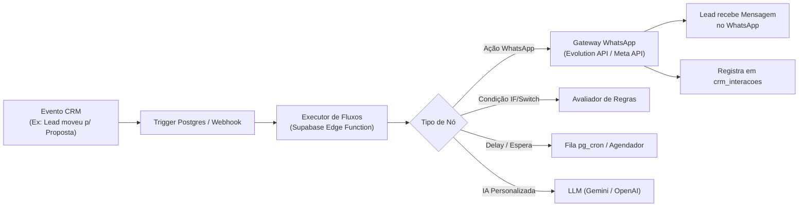

# 🚀 Plano de Implementação: Módulo de Automação de Mensagens (Estilo n8n)

> **Objetivo:** Criar um módulo completo de automação visual de fluxos de mensagens baseado em nós (inspirado no n8n) para o Prancheto.IA, permitindo disparar ações multicanal (com foco inicial em WhatsApp) a partir de eventos do CRM (como a mudança de etapa de um lead no funil).

---

## 1. Visão Geral da Arquitetura

O módulo de automação permitirá aos usuários desenhar jornadas de comunicação inteligentes arrastando e conectando nós em um canvas infinito, com feedback visual em tempo real e monitoramento de execuções.



---

## 2. Escolha e Comparativo das Integrações de WhatsApp

Para atender diferentes perfis de clientes (desde pequenas empresas que querem plugar o próprio WhatsApp via QR Code sem custo de mensagens, até médias/grandes operações que exigem a API Oficial da Meta), a arquitetura será **modular e agnóstica de provedor**:

| Critério | Evolution API (Recomendada) | WhatsApp Cloud API (Meta Oficial) | Z-API (Gateway Nacional) |
| :--- | :--- | :--- | :--- |
| **Tipo de Conexão** | QR Code (Baileys) ou Oficial Meta | API Oficial Meta (WABA / Cloud API) | QR Code Gerenciado via SaaS |
| **Custo por Mensagem** | **R$ 0,00** (Sem taxas da Meta) | Pago por conversa ativa (Tabela Meta) | Mensalidade fixa por instância |
| **Risco de Banimento** | Médio (se fizer disparo massivo abusivo) | **Zero** (100% em conformidade) | Médio (se fizer disparo abusivo) |
| **Recursos Especiais** | Digitando..., gravando áudio, áudio PTT | Apenas templates aprovados nas primeiras 24h | Suporte a áudio, botões e listas |
| **Velocidade de Setup** | Imediato (escaneou o QR Code, conectou) | 1 a 3 dias (verificação de empresa Meta) | Imediato (QR Code no painel) |
| **Hospedagem** | Self-hosted (Docker) ou Cloud (VPS) | Nuvem da Meta | Nuvem Z-API |

### 💡 Decisão de Arquitetura Recomendada:
1. **Fase 1 (MVP Rápido & Adoção Máxima):** Suporte nativo à **Evolution API** via container Docker gerenciado pelo Prancheto.IA ou chave de API do cliente. Permite conexão instantânea via QR Code, gravação simulada de áudio e zero custo por mensagem.
2. **Fase 2 (Enterprise & Compliance):** Adicionar driver da **Meta Cloud API Oficial** como opção de canal na mesma interface para empresas que exigem número oficial verificado.

---

## 3. Modelo de Dados (Supabase / PostgreSQL)

Serão criadas 5 tabelas principais no banco de dados com isolamento estrito via RLS (`tenant_id`):

```sql
-- 1. Definição do Fluxo (Workflow)
CREATE TABLE public.automacao_fluxos (
    id UUID PRIMARY KEY DEFAULT gen_random_uuid(),
    tenant_id UUID NOT NULL REFERENCES public.tenants(id) ON DELETE CASCADE,
    nome TEXT NOT NULL,
    descricao TEXT,
    ativo BOOLEAN NOT NULL DEFAULT false,
    trigger_tipo TEXT NOT NULL, -- 'lead_etapa_alterada', 'lead_criado', 'webhook', 'tempo'
    trigger_config JSONB NOT NULL DEFAULT '{}'::jsonb, -- ex: {"etapa_origem": "*", "etapa_destino": "proposta"}
    nodes JSONB NOT NULL DEFAULT '[]'::jsonb, -- Nós do canvas (posição, tipo, config)
    edges JSONB NOT NULL DEFAULT '[]'::jsonb, -- Conexões entre nós
    versao INTEGER NOT NULL DEFAULT 1,
    execucoes_count INTEGER NOT NULL DEFAULT 0,
    criado_por UUID REFERENCES public.usuarios(id) ON DELETE SET NULL,
    criado_em TIMESTAMPTZ NOT NULL DEFAULT now(),
    atualizado_em TIMESTAMPTZ NOT NULL DEFAULT now()
);

-- 2. Histórico de Execuções de cada Lead no Fluxo
CREATE TABLE public.automacao_execucoes (
    id UUID PRIMARY KEY DEFAULT gen_random_uuid(),
    tenant_id UUID NOT NULL REFERENCES public.tenants(id) ON DELETE CASCADE,
    fluxo_id UUID NOT NULL REFERENCES public.automacao_fluxos(id) ON DELETE CASCADE,
    contato_id UUID REFERENCES public.crm_contatos(id) ON DELETE SET NULL,
    trigger_payload JSONB NOT NULL DEFAULT '{}'::jsonb,
    node_atual TEXT,
    status TEXT NOT NULL DEFAULT 'executando', -- 'executando', 'aguardando_delay', 'concluido', 'falha'
    etapas_executadas JSONB NOT NULL DEFAULT '[]'::jsonb, -- log passo a passo de cada nó
    erro TEXT,
    iniciado_em TIMESTAMPTZ NOT NULL DEFAULT now(),
    finalizado_em TIMESTAMPTZ
);

-- 3. Fila de Delays e Agendamentos
CREATE TABLE public.automacao_delays_fila (
    id UUID PRIMARY KEY DEFAULT gen_random_uuid(),
    tenant_id UUID NOT NULL REFERENCES public.tenants(id) ON DELETE CASCADE,
    execucao_id UUID NOT NULL REFERENCES public.automacao_execucoes(id) ON DELETE CASCADE,
    fluxo_id UUID NOT NULL REFERENCES public.automacao_fluxos(id) ON DELETE CASCADE,
    proximo_node_id TEXT NOT NULL,
    executar_em TIMESTAMPTZ NOT NULL,
    status TEXT NOT NULL DEFAULT 'pendente', -- 'pendente', 'processando', 'concluido', 'cancelado'
    criado_em TIMESTAMPTZ NOT NULL DEFAULT now()
);

-- 4. Instâncias e Conexões de WhatsApp
CREATE TABLE public.whatsapp_conexoes (
    id UUID PRIMARY KEY DEFAULT gen_random_uuid(),
    tenant_id UUID NOT NULL REFERENCES public.tenants(id) ON DELETE CASCADE,
    nome TEXT NOT NULL,
    provedor TEXT NOT NULL DEFAULT 'evolution', -- 'evolution', 'zapi', 'meta_cloud'
    instancia_nome TEXT NOT NULL,
    api_url TEXT,
    api_token TEXT,
    telefone_conectado TEXT,
    status TEXT NOT NULL DEFAULT 'desconectado', -- 'conectado', 'desconectado', 'gerando_qrcode'
    qrcode_base64 TEXT,
    padrao BOOLEAN NOT NULL DEFAULT false,
    criado_em TIMESTAMPTZ NOT NULL DEFAULT now(),
    atualizado_em TIMESTAMPTZ NOT NULL DEFAULT now()
);

-- 5. Templates de Mensagens Rápidas / Variáveis
CREATE TABLE public.whatsapp_templates (
    id UUID PRIMARY KEY DEFAULT gen_random_uuid(),
    tenant_id UUID NOT NULL REFERENCES public.tenants(id) ON DELETE CASCADE,
    titulo TEXT NOT NULL,
    mensagem TEXT NOT NULL, -- Suporta {{lead.nome}}, {{lead.empresa}}, {{lead.valor}}
    midia_url TEXT,
    tipo TEXT NOT NULL DEFAULT 'texto', -- 'texto', 'imagem', 'audio', 'documento'
    criado_em TIMESTAMPTZ NOT NULL DEFAULT now()
);
```

---

## 4. Estrutura das Páginas e UI no Frontend (Inspirado no n8n)

A experiência será organizada dentro de uma nova rota: `/dashboard/automacoes`.

### 4.1. Tela 1: Lista de Automações (`/dashboard/automacoes`)
- **Cards de Métricas:** Total de fluxos ativos, mensagens enviadas no mês, taxa de entrega e execuções ativas.
- **Tabela/Grade de Fluxos:**
  - Nome do fluxo, gatilho principal (ícone de funil/etapa), status switch (Ativo/Inativo), total de execuções.
  - Ações rápidas: *Editar no Canvas*, *Duplicar*, *Ver Logs*, *Excluir*.
- **Aba "Conexões WhatsApp":**
  - Card para conectar número via QR Code diretamente na tela.
  - Indicador de status (bolinha verde "Conectado", número pareado e nível de bateria).

### 4.2. Tela 2: Canvas Visual de Edição (`/dashboard/automacoes/:id`)
Construído com **React Flow (`@xyflow/react`)**, perfeitamente alinhado com o Design System Emitly (paleta Obsidian Slate / Royal Cobalt):
- **Barra Superior (Toolbar):**
  - Nome editável do fluxo, botão de voltar, botão de "Testar Fluxo", status (Rascunho / Publicado), botão de "Salvar" e "Publicar".
- **Painel Lateral de Nós (Node Palette):**
  - **Gatilhos (Triggers):** Lead mudou de etapa, Novo lead, Lead ganho/perdido, Webhook externo.
  - **Ações:** Enviar WhatsApp (Texto/Mídia/Áudio), Mover Etapa do Lead, Criar Tarefa no CRM, Gerar Resposta com IA (Gemini).
  - **Lógica & Tempo:** Condição IF (se valor > X), Delay/Espera (minutos, horas, dias), Horário Comercial (não enviar à noite/fins de semana).
- **Área Central (Canvas):**
  - Canvas infinito com grid pontilhado, suporte a zoom (scroll), arrasto e snap-to-grid.
  - Mini-mapa no canto inferior esquerdo.
  - Linhas curvas animadas conectando as saídas e entradas dos nós com cores correspondentes.
- **Drawer de Configuração do Nó (Side Sheet à direita):**
  - Abre ao clicar em qualquer nó.
  - Permite configurar o template da mensagem com editor de variáveis inteligentes:
    - *Exemplo:* `"Olá {{lead.primeiro_nome}}, tudo bem? Vi que sua empresa {{lead.empresa}} está interessada no projeto. Segue a apresentação em anexo."*

### 4.3. Tela 3: Histórico e Logs de Execução (`/dashboard/automacoes/:id/execucoes`)
- Lista de todas as vezes que o fluxo rodou para cada lead.
- Clicar em uma execução destaca visualmente o caminho percorrido pelos nós no canvas (verde para sucesso, vermelho para erro, azul piscante para etapa atual aguardando delay).

---

## 5. Catálogo de Nós para o MVP

### Nós de Gatilho (Triggers)
1. **Etapa do Funil Alterada:**
   - *Campos:* Pipeline selecionada, Etapa de origem (opcional ou "Qualquer"), Etapa de destino (ex: "Proposta Comercial").
2. **Novo Lead Criado:**
   - *Campos:* Filtro por origem (Site, Anúncio, Indicação).
3. **Status do Lead Alterado:**
   - *Campos:* Fechado (Ganho) ou Perdido.

### Nós de Ação (Actions)
1. **Enviar WhatsApp (Evolution API / Meta):**
   - *Campos:* Conexão WhatsApp de saída, Tipo (Texto, Áudio simulado gravando, Imagem, PDF), Mensagem com placeholders dinâmicos, Delay humano simulado (ex: "esperar digitando 3 segundos antes de enviar").
2. **Gerar Mensagem com IA (Gemini):**
   - *Campos:* Prompt base ("Crie uma mensagem persuasiva e amigável para retomar contato com o lead com base nas observações {{lead.observacoes}}").
3. **Mover Etapa do Lead:**
   - *Campos:* Avançar lead para a próxima etapa ou etapa específica após envio com sucesso.
4. **Criar Notificação / Tarefa:**
   - *Campos:* Criar tarefa com prazo para o vendedor responsável se o lead não responder após o follow-up.

### Nós de Controle de Fluxo (Flow Control)
1. **Delay Inteligente (Aguardar):**
   - *Campos:* Tempo relativo (ex: 30 minutos, 2 dias) ou "Aguardar até o próximo dia útil às 09:30".
2. **Condição IF (Branching):**
   - *Campos:* Variável (ex: `lead.valor_estimado`), Operador (`>`, `<`, `==`), Valor de comparação. Cria saída `Verdadeiro` e `Falso`.

---

## 6. Motor de Execução (Engine) & Supabase Edge Functions

### 6.1. Gatilho no PostgreSQL (Database Trigger)
Quando `status_funil` em `crm_contatos` é atualizado, uma trigger nativa insere um job na tabela de fila ou faz um dispatch via `pg_net` para a Edge Function:

```sql
CREATE OR REPLACE FUNCTION public.fn_trigger_automacao_lead_etapa()
RETURNS TRIGGER AS $$
BEGIN
    IF (OLD.status_funil IS DISTINCT FROM NEW.status_funil) THEN
        INSERT INTO public.automacao_eventos_fila (tenant_id, contato_id, evento, dados_antigos, dados_novos)
        VALUES (
            NEW.tenant_id,
            NEW.id,
            'lead_etapa_alterada',
            jsonb_build_object('status_funil', OLD.status_funil),
            jsonb_build_object('status_funil', NEW.status_funil, 'nome', NEW.nome, 'telefone', NEW.telefone)
        );
    END IF;
    RETURN NEW;
END;
$$ LANGUAGE plpgsql SECURITY DEFINER;
```

### 6.2. Edge Function `automacao-runner`
- Lê o evento, busca todos os fluxos ativos do `tenant_id` cujo gatilho coincida com a transição de etapa.
- Inicia uma `automacao_execucao`.
- Itera nó a nó pela árvore de adjacência (`edges`):
  - Executa ações imediatas (envio WhatsApp, chamadas IA).
  - Ao encontrar um nó de **Delay**, grava o estado em `automacao_delays_fila` e pausa a execução até o horário determinado.
  - Ao concluir, atualiza o status para `concluido` e grava o registro na timeline do lead em `crm_interacoes`.

---

## 7. Roteiro de Execução por Fases (Milestones)

### 📌 Fase 1: Fundação do Banco de Dados & Conexão WhatsApp (Semana 1)
- [ ] Criação das migrations das tabelas `automacao_fluxos`, `automacao_execucoes`, `whatsapp_conexoes` e `automacao_delays_fila`.
- [ ] Implementação de RLS e políticas de segurança por tenant.
- [ ] Criação do painel de conexão WhatsApp com geração e escaneamento de QR Code (Evolution API).
- [ ] Teste de envio de mensagem de teste direta para validar conectividade.

### 📌 Fase 2: Interface Visual Canvas estilo n8n (Semana 2)
- [ ] Instalação e configuração de `@xyflow/react` (React Flow) compatível com o Tailwind e temas Claro/Escuro do Prancheto.
- [ ] Criação dos componentes visuais customizados para cada tipo de nó (Gatilho, WhatsApp, Delay, Condição, IA).
- [ ] Painel lateral para arrastar nós e sheet lateral para parametrização do nó selecionado.
- [ ] Validador de fluxo (impedir nós soltos ou ciclos infinitos antes de salvar).

### 📌 Fase 3: Motor de Execução & Triggers do CRM (Semana 3)
- [ ] Triggers no banco para monitorar movimentação de leads no funil (`crm_contatos`).
- [ ] Implementação da Edge Function `automacao-executor`.
- [ ] Substituição dinâmica de variáveis nos templates (`{{lead.nome}}`, `{{lead.empresa}}`, etc.).
- [ ] Registro automático de cada mensagem disparada na tabela `crm_interacoes` com tipo `'whatsapp'`.

### 📌 Fase 4: Delays, Condicionais e Logs (Semana 4)
- [ ] Processador de agendamentos para o nó de Delay (via `pg_cron` no Supabase).
- [ ] Tela de logs de execução com destaque visual dos nós percorridos.
- [ ] Testes de ponta a ponta: mover lead no Kanban e receber mensagem automática formatada no WhatsApp.

